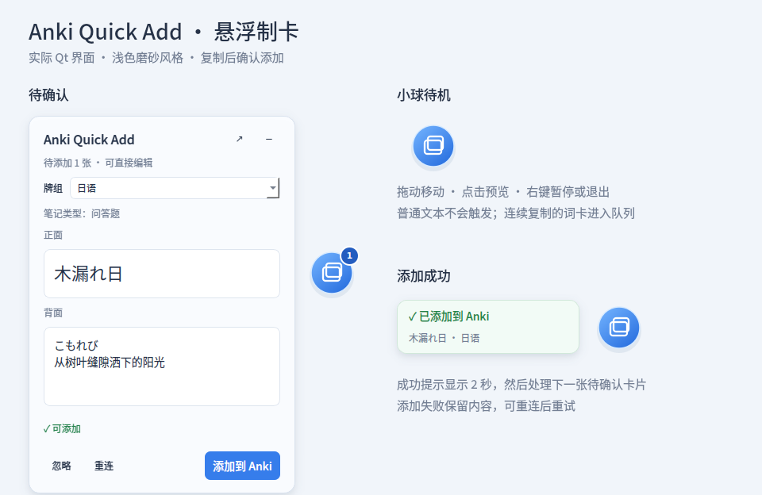

# Anki Quick Add

当前版本：**v1.3.1**（2026-10-15）。更新内容见 [更新日志](CHANGELOG.md)。

Anki Quick Add 是一个面向外语学习的 LLM 查词与 Anki 制卡工具，主要解决三个问题：传统手段查词步骤多、速度慢；查到内容后还要手动整理格式再制成 Anki 卡片；通用 LLM 的查询范围和回答侧重不固定，容易出现信息过多、过少或不符合个人学习习惯。

本工具的功能包括：使用可自定义的提示词规定 LLM 的查询方式、解释深度和制卡格式，再将结果快速检查、修改、查重并加入 Anki。

> Anki Quick Add 是独立第三方项目，与 Anki 或 Ankitects 无隶属关系，也未获得其官方认可。

## 主要功能

- 主窗口打开时，复制符合格式的卡片 JSON 即可自动填入正面和背面，无须手动粘贴（仍支持手动粘贴）。
- 加入前可以直接修改卡片内容。
- 自动连接 Anki，并检查是否已有重复卡片。
- 可以直接选择要加入的 Anki 牌组。
- 添加成功后自动清空，方便继续处理下一张卡片。
- 内置「纯文本／智能配图」两套日语制卡提示词，切换后可以分别编辑、保存与复制。
- 各模式单独支持「恢复默认」，升级时保留旧版自定义纯文本提示词。
- Anki 未连接时仍然可以粘贴、查看和编辑卡片。
- 浅色悬浮球常驻其他窗口上方，后台识别剪贴板中的词卡 JSON。
- 连续复制的词卡依次排队，可手动确认或开启自动添加；失败时保留内容。

## 使用方法

1. 安装并打开 Anki。
2. 在 Anki 中安装 **AnkiConnect** 插件：打开 工具 → 插件 → 获取插件，输入插件代码 2055492159，安装完成后重启 Anki。Anki Quick Add 会通过 AnkiConnect 与本机 Anki 通信。
3. 从 [GitHub Releases](../../releases) 下载 Windows 发布包 `AnkiQuickAdd-Windows.zip`，完整解压后运行：

```text
AnkiQuickAdd/AnkiQuickAdd.exe
```

   不要只把 EXE 单独复制出来；Qt/PySide6 运行库位于同一目录下的 `_internal` 文件夹中。

4. 点击右上角「制卡提示词」，在「纯文本／智能配图」间切换，点击「复制制卡提示词」并粘贴给 ChatGPT。
5. 从 LLM 复制合法的卡片 JSON（也支持独立的 JSON 代码围栏）；主窗口会自动识别并填入「制卡内容」，也可手动 Ctrl+V。
6. 检查或修改正面、背面。
7. 选择牌组，然后点击「加入 Anki」。

## 主窗口剪贴板自动填卡

主窗口**处于显示状态**时，复制合法的 `front/back` 词卡 JSON，会立即自动填入「制卡内容」并刷新「正面／背面」预览，**不会自动点击「加入 Anki」**。同时每 400ms 进行一次剪贴板检查，避免 Windows 偶发丢失通知。

- 普通文本、无效 JSON、图片剪贴板数据不会替换当前草稿。
- 复制同一张词卡的 JSON（包含不同空白、JSON 代码围栏）不会覆盖已手动编辑的正背面内容。
- 添加过程中复制的新词卡会按顺序等待，不会漏掉；主窗口显示剩余数量。当前卡片添加成功或点击「清空」后，自动显示下一张，仍需手动确认添加。添加失败时保留当前文字、图片和等待中的词卡。
- 复制一张**不同**的合法词卡将替换当前草稿，行为与手动粘贴新 JSON 一致；如果当前文字草稿已有图片，按原有保护规则清除前一张图片，避免图片关联到错误单词。
- 已有等待队列时，新复制的卡片继续排队，不会覆盖当前草稿。等待队列与悬浮模式共用，切换窗口时继续保留；退出程序后不保留。
- 进入悬浮模式后暂停主窗口自动填入，仍由悬浮队列独立接收复制的 JSON；返回主窗口时不会把此前复制的词卡重复填入。
- 牌组切换不再显示红色「牌组（非默认）」警告；仍可正常选择非默认牌组，提交按钮保留目标牌组提示。

## 两种制卡提示词

「制卡提示词」弹出框顶部可以切换两种预设：

- **纯文本**（首次升级默认）：完全保留 v1.2.0 的原有日语单词、变形、句子与截图查询规则，适合悬浮球纯文字快速制卡。
- **智能配图**：先判断图片是否真正有记忆价值；值得配图时尝试生成**不带文字的独立图片**，再额外提供仅含 `front/back` 的可单独复制 JSON 代码块；不值得配图或生成失败则只输出原生 JSON。

两种提示词**独立保存**，切换前自动保存正在编辑的文本。复制和「恢复默认」仅操作当前预设。模式选择也会在下一次启动时恢复；原来保存在 `window.json` 的 `format_prompt` 不会被替换。

「恢复默认」只恢复当前预设，不修改剪贴板；需要复制时点击「复制制卡提示词」。编辑 JSON 时即使暂时格式不完整，也只显示错误提示，不会自动弹出提示词窗口。设置使用原子替换保存，写入或替换失败时保留原文件。

图文模式不是 Quick Add 内置的 AI 生成器。ChatGPT 网页端是否实际调用生图工具仍由其提供的能力决定。如果生成了图片，请复制 JSON 到主窗口，再使用「粘贴图片」；悬浮球仍只接收纯文本 JSON。

## 卡片格式

最基本的格式：

```json
{
  "front": "単語",
  "back": "假名：たんご\n词性：名词\n释义：单词；词语"
}
```

程序只使用 `front` 和 `back` 两个字段，配图不是 JSON 字段。

## 主窗口图片制卡

主窗口的「卡片预览」右侧提供一个**拆分按钮**：左侧「粘贴图片」直接读取剪贴板，右侧下拉箭头打开「选择本地图片…」。顶部「悬浮制卡」和「制卡提示词」为紧凑工具入口，功能不变。

1. 按原方法在「制卡内容」粘贴 JSON，也可以直接编辑正面、背面。
2. 在 ChatGPT 生成图片后点击图片自身的复制按钮，再回到主窗口点击「粘贴图片」；如需导入本地 PNG/JPEG/WebP/BMP/GIF，点击同一按钮右侧的下拉箭头，再选择「选择本地图片…」。
3. 图片缩略图出现在卡片预览标题旁。点击缩略图查看大图，点击「移除」删除附件。
4. 选择牌组，点击「加入 Anki」。图像会追加到所配置的**背面**字段中，与词卡文字一起写入 Anki。

- 图片可先于 JSON 导入；替换已有 JSON 草稿时会清除旧图片，防止错绑。
- 支持最大 **2500 万像素**、编码后的 PNG 不超过 **10 MB**；本地源文件不超过 15 MB。
- 添加失败保留文字和图片；成功添加或点击「清空」后清除图片。
- 图片属于当前主窗口草稿，不能带入悬浮模式。要进入悬浮模式，请先完成图文制卡或移除图片。
- 悬浮快速制卡仍然只识别文字 JSON；不识别图片，也不自动为词卡生成图片。
- 图片处理均在本机进行，使用 AnkiConnect 的 `addNote.picture`，不需要模型 API Key。

## 悬浮制卡

主窗口右上角点击「悬浮制卡」，窗口收起为可拖动的小球。在 ChatGPT 或其他应用复制符合上述格式的 JSON，预览会自动出现，并且不会抢走当前应用的输入焦点。

- 小球角标显示待添加数量；重复的剪贴板内容不会反复入队。
- 主窗口已经读取的剪贴板内容不会因进入悬浮模式而再次入队；忽略一张卡片后，可以主动重新复制它再次制卡，定时检查不会自动恢复刚忽略的卡片。
- 默认使用确认模式：在预览中检查或直接编辑正面、背面，选择牌组，再点击「添加到 Anki」。
- 「快速制卡」标题旁的「自动添加」开关默认关闭。开启后，新复制的合格词卡 JSON 会在连接校验和全库查重通过后直接加入当前牌组，不弹预览或成功提示；重复卡片自动跳过。小球绿点表示自动添加已开启，悬停可查看目标牌组和本次添加/跳过数量。
- 自动添加遇到断连或添加失败时暂停，保留当前内容和队列，小球显示红点。点击小球查看原因并重试连接。已有草稿、开启前的队列以及手动编辑的卡片仍需确认；关闭开关取消尚未提交的自动添加，返回主窗口也会关闭该模式。开关仅在当前悬浮会话生效。
- 确认模式添加成功后显示「已添加到 Anki」约 2 秒，然后显示下一张待确认卡片。查重发现已有卡片时不会提交。
- 确认模式下，Anki 未连接或添加失败时保留内容。点击「重连」或「重试连接」，查重通过后再次确认添加。
- 点击小球或预览右上角的减号图标可收起预览。点击窗口图标返回主窗口；编辑内容和牌组保持同步，返回主窗口后停止后台监听。
- 右键小球可以打开主窗口、暂停/恢复监听或退出。退出会丢弃尚未添加的卡片；本版本的队列保存在当前会话中。
- 笔记类型使用现有 `config.json` 配置，此版本仍处理 `front/back` 两个字段。

源码运行时可直接进入悬浮模式：

```powershell
python app.py --floating
```




## 运行要求

- Windows
- Anki
- AnkiConnect

Windows 发布包已经包含 Python、PySide6 和 Qt 运行时，不需要另外安装 Python 或 Qt。


## 从源码运行

需要 Python 3.12。

```powershell
python -m pip install -r requirements.txt
python app.py
```

悬浮窗行为验证（使用模拟 Anki，不写入真实卡片）：

```powershell
python tools/verify_runtime_behavior.py
python tools/verify_floating_behavior.py
python tools/capture_floating_ui.py
python tools/capture_image_ui.py
```

如需构建 Windows 发布包：

```powershell
python -m pip install -r requirements-build.txt
pwsh -NoProfile -File tools/build_windows.ps1
```

## 许可证

Anki Quick Add 源码使用 MIT License。Windows 发布包包含 PySide6、Qt、Python、OpenSSL、PyInstaller bootloader 以及开源字体，它们分别遵循各自的许可证。详见 `THIRD_PARTY_NOTICES.md` 和 `licenses/`。
